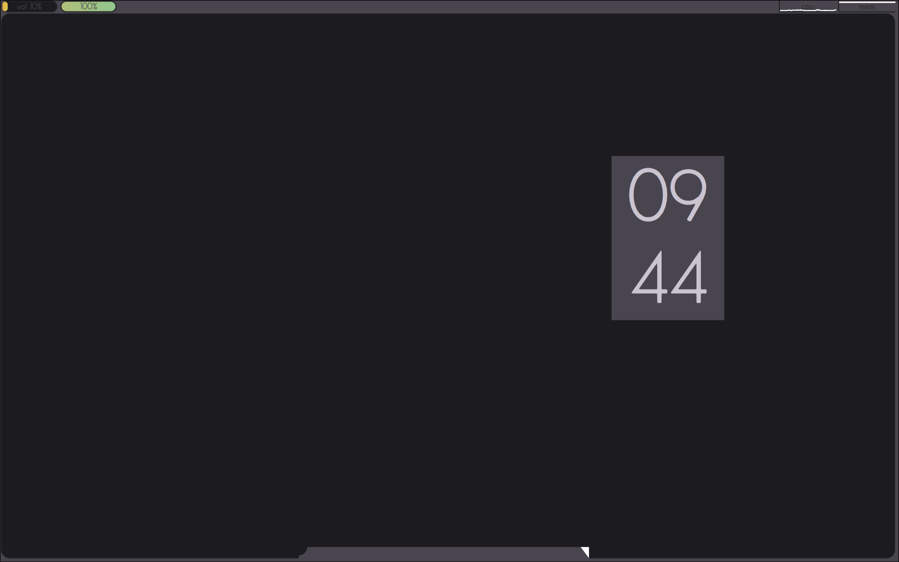

# focus

a placeholder name.



# About

I sort of gave up on maurice, my previous attempt to learn Quickshell, so I wanted to try something new and try to learn more.
Not really a "rice", it's mostly just a Quickshell.. shell. It does come with the basics needed to get a desktop showing stuff (with zero system-level config), but there isn't much "ricing" beyond Quickshell.

## Quickshell

The most visual aspect of the project, it's the bar, lock screen (WIP) and background (no wallpaper yet). The engine reacts to any changes, so any change to a value gives immediate visual feedback, and you don't need to worry about drawing a frame or updating stuff like you would literally anywhere else.

## Everything Else

Hyprland/Kitty/Fish, the basics. They're setup for ease of use (and highly subjective configs), but they do work with Quickshell to make a desktop look more uniform. The whole project needs work, so everything looks bland right now (as you can see with that super *cool* screenshot).

## Process

My problem with maurice was how the code was barely reusable, I genuinely sucked at not making spaghetti code and it caught up to me once I had put a lot of hours into it.

My aim with this project was to try to reuse code more, and I think I did do better (`Graph`, `Gauge`, for example). It's obviously not much and honestly a poor excuse for a "rice", but I would like to work on it more and try to implement features I had planned. Quickshell makes reusing code stupid easy, you just make your own custom component and design it in a way that can actually be reused. I'm going to be doing this more, but I think it's fair to say I have cut down a little on the bloat of code that is maurice.

## Installing

Get the latest [release](https://github.com/MrFriedOk/focus/releases).

System-level configuring/installs are not handled.

Ensure you have the below installed. Configuration may not be necessary

### Dependencies

- `hyprland`, this is a Hyprland rice.
- `pipewire`, required for audio ctl and monitoring.
- `quickshell`, Quickshell is the majority of this rice.
- `upower`, required for battery monitoring. Shell checks for battery, so if it is not installed, the widget probably wont show up.

#### Others

Mostly for my convenience, but these are things I have installed/configured/used somewhere in a config. Probably not super crucial to functioning.

- `firefox`
- `hyprshot`, screenshot util.
- `kitty` (Hyprland actually recommends this)
- `fish`, shell
- `starship`, fish initializes starship. No config required, but this rice does not have any config for it, so defaults will be used.
- `eza`, better `ls`. Included in fish config.
- `ttf-atkinson-hyperlegible`, font in the kitty config. Not necessary, just make sure you have _a_ font installed.
- NMS GeoSans, stylized font used in Quickshell. Also not necessary, but looks kinda cool [find it here](https://github.com/NMSCD/No-Mans-Sky-Universal-Font/).

### Guide

I main Arch Linux. I am sorry, but the line below is only applicable for `pacman`

```
sudo pacman -S --needed hyprland quickshell pipewire upower
```

Each release (and the repo) contains an install script. Ensure that this script has execute perms. All it does is back up directories and copy the data from the `config` folder and puts them in the default config path for their corresponding app.

Make sure you get the release's `.zip`, not the source code. Extract it and then run the `install.sh` script.

> [!WARNING]
> I have run this script several times but please run it with caution. Treat every directory it will replace and backup (`quickshell`,`fish`,`kitty`,`hypr`) as if it will **_NOT_** be backed up.
> Be careful with scripts online!

Once the script has been run and the directories are in the right place, you should be good. Quickshell will not run, but should when Hyprland starts next session. Alternatively, run `qs -d` in the terminal (if already in Hyprland) to launch Quickshell and detach it from the terminal.
It may also be helpful to run `hyprctl reload` to refresh the Hyprland config. Doing this will not run auto exec commands, however.

## Using

Mentioned before, highly subjective keybinds. Hyprland's keybinding is the bare minimum _for me_, I haven't looked into what objectively works better but this is just what I am used to. Hyprland is also set to the dwindle layout.

- Super T, open Kitty
- Super {num}, change workspaces
- Super Shift {num}, move workspace and follow
- Super S, open "special" workspace (known as scratchpad in [illogical-impulse](https://github.com/end-4/dots-hyprland/) I think?)
- Super F, fullscreen focused window
- Super D, maximize focused window
- Some audio keys bindings set up (vol up/down), just set the XF86 bindings so your keyboard may not have them
- Super arrow, focus in direction
- Super Shift arrow, move window in direction

Nothing in the Quickshell aspect is really interactive as of now, but the clock, being the only one of its kind for now (a `Dragable`, horrid spelling) can be moved around and stuff. Its position is saved to disk when placed down, so it will stay.

The volume gauge can be scrolled to increase/decrease. I really need to fix it tho. Be careful with this one, it isn't particularly strong in terms of scrolling, but you shouldn't raise it too high (especially if you use a trackpad).

## References

- [md3](https://paletacolorpro.com/en/material-design)
- [Quickshell docs](https://quickshell.org/docs/v0.3.2/)
- [Qt docs](https://doc.qt.io/qt-6/)
- [`caelestia-dots` for inspiration](https://github.com/caelestia-dots/shell)
- [Hyprland wiki](https://wiki.hypr.land/)
- [`illogical-impulse` for inspiration](https://github.com/end-4/dots-hyprland/)
